[](https://hub.docker.com/r/orangehrm/orangehrm) [](https://sourceforge.net/projects/orangehrm/) [](https://sourceforge.net/projects/orangehrm/)

# OrangeHRM Starter Application

# BÀI TẬP LỚN: ĐÁNH GIÁ VÀ KIỂM ĐỊNH CHẤT LƯỢNG PHẦN MỀM
**Đề bài: "Kiểm thử hệ thống quản lý nhân sự OrangeHRM"**

---

## TÓM TẮT
Cùng với sự phát triển mạnh mẽ của công nghệ thông tin trong thời đại 4.0, các doanh nghiệp ngày càng chú trọng đến việc ứng dụng phần mềm vào quản trị nguồn nhân lực (HRM) để cải thiện hiệu suất, giảm thiểu rủi ro từ các sai sót thủ công và tối ưu hóa hoạt động vận hành nội bộ. Việc sử dụng các nền tảng quản trị mở như OrangeHRM giúp số hóa toàn bộ quy trình quản lý thông tin nhân viên, chấm công, tuyển dụng, và nghỉ phép một cách hiệu quả, minh bạch và chính xác tuyệt đối.

Chúng em đã lựa chọn đề tài kiểm thử hệ thống OrangeHRM với mục tiêu thiết kế và triển khai một quy trình kiểm thử toàn diện, tuân thủ các chuẩn mực công nghiệp để đánh giá chất lượng phần mềm này. Việc đầu tiên là thiết kế tài liệu đặc tả (SRS) bao gồm việc thu thập các yêu cầu chức năng và phi chức năng, phân rã chi tiết toàn bộ các Use Case, thiết kế các biểu đồ tuần tự và biểu đồ luồng nghiệp vụ (Activity Diagram). Sau đó, nhóm tiến hành lập kế hoạch kiểm thử (Test Plan) theo tiêu chuẩn IEEE 829 và thực thi kiểm thử (Test Execution) ở nhiều cấp độ để đảm bảo hệ thống hoạt động ổn định dưới nhiều góc độ.

Trong bài báo cáo này, chúng em sẽ trình bày cực kỳ chi tiết về phương pháp kiểm thử hộp trắng (phân tích đường cơ bản, giá trị biên) và kiểm thử hộp đen (sử dụng ma trận True/False cho 9 chức năng cốt lõi). Đặc biệt, báo cáo tích hợp việc thực thi kiểm thử hiệu năng/chịu tải bằng công cụ **Apache JMeter** nhằm đánh giá khách quan sức mạnh của hệ thống máy chủ và phát hiện các giới hạn chịu tải trước khi sập (Breaking Point). Cuối cùng, chúng em sẽ đưa ra báo cáo tổng hợp kết quả (Test Report), phân tích các rủi ro, danh sách lỗi (Defect log) và các cải tiến đề xuất cho đội ngũ phát triển.


## PHẦN I: TÀI LIỆU ĐẶC TẢ YÊU CẦU PHẦN MỀM (SRS)

### 1. Giới thiệu
**1.1 Mục đích**
Phần mềm quản lý nhân sự không chỉ là một kho lưu trữ hồ sơ điện tử thụ động mà còn là một bộ máy điều phối nguồn lực, ghi nhận hiệu suất và tối ưu hóa các quy trình doanh nghiệp khổng lồ. Hệ thống OrangeHRM cung cấp tính năng linh hoạt giúp quản lý phê duyệt nghỉ phép, theo dõi thông tin cá nhân, chấm công và quản lý tài sản công ty. Báo cáo này đặc tả chi tiết các chức năng trên nhằm tạo ra cơ sở vững chắc, minh bạch và chính xác tuyệt đối phục vụ cho quá trình lên kịch bản kiểm thử (Test Cases). Việc hiểu rõ luồng đi của dữ liệu là yếu tố kiên quyết để tìm ra các lỗ hổng (Bugs) tiềm ẩn.

**1.2 Phạm vi**
Tài liệu hướng đến các nhóm người dùng: Nhân viên (Employee), Quản lý bộ phận (Supervisor) và Quản trị viên (Admin) của bộ phận Nhân sự (HR). Các tính năng phản ánh quy trình quản trị hồ sơ, thay đổi thông tin nội bộ, quy trình duyệt đơn xin nghỉ phép nhiều cấp, và cơ chế bảo mật xác thực tài khoản đa tầng. 

**1.3 Từ điển thuật ngữ**
| Thuật ngữ | Định nghĩa chi tiết |
|---|---|
| SRS | Software Requirement Specification – Tài liệu đặc tả yêu cầu phần mềm, mô tả chi tiết những gì phần mềm phải làm. |
| HRM | Human Resource Management – Quản trị nguồn nhân lực, bao gồm tuyển dụng, đào tạo, đánh giá và trả lương. |
| PIM | Personal Information Management – Module quản lý thông tin cá nhân (Họ tên, ngày sinh, bảo hiểm, hợp đồng) của nhân sự. |
| ESS | Employee Self Service – Cổng thông tin tự phục vụ, nơi nhân viên tự thao tác (xin phép, xem lương) mà không cần qua nhân sự. |
| BVA | Boundary Value Analysis - Phân tích giá trị biên, một kỹ thuật thiết kế testcase tập trung vào các điểm giới hạn của dữ liệu. |
| JMeter | Apache JMeter - Công cụ mã nguồn mở dùng để kiểm thử hiệu năng (Performance Test) và độ chịu tải (Load Test) bằng cách giả lập lượng lớn request. |

**1.4 Tổng quát**
Tài liệu được chia thành 3 phần chính: 
- Phần 1: Giới thiệu và thiết lập cái nhìn tổng quát về hệ thống.
- Phần 2: Các yêu cầu chức năng (Chi tiết hóa các Tác nhân, Sơ đồ chức năng, Biểu đồ Use Case tổng quan và phân rã, Biểu đồ luồng, Biểu đồ tuần tự cho toàn bộ 9 chức năng).
- Phần 3: Các yêu cầu phi chức năng (Giao diện, bảo mật, hiệu năng).

---

### 2. Các yêu cầu chức năng

**2.1 Các tác nhân (Actors)**
Hệ thống OrangeHRM được xây dựng xoay quanh 3 nhóm tác nhân chính, có mức độ phân quyền từ thấp lên cao:
1. **Nhân viên (Employee):** Người dùng cấp thấp nhất. Truy cập vào cổng ESS để tự theo dõi thông tin hợp đồng của bản thân, thực hiện chấm công hàng ngày, gửi đơn xin nghỉ phép, theo dõi lịch sử nghỉ phép và đổi mật khẩu cá nhân.
2. **Quản lý (Supervisor/Manager):** Quản lý cấp trung. Thừa kế toàn bộ quyền của Nhân viên. Có quyền xem danh sách nhân sự thuộc phòng ban mình quản lý, nhận thông báo và trực tiếp Duyệt (Approve) hoặc Từ chối (Reject) các đơn xin nghỉ phép, thực hiện đánh giá KPI.
3. **Quản trị viên (Admin):** Người dùng cấp cao nhất (Super User). Nắm giữ quyền sinh sát toàn bộ hệ thống. Thiết lập sơ đồ tổ chức, thêm/sửa/xóa hồ sơ nhân sự toàn công ty, quản lý và phân quyền tài khoản, cấp phát ngày phép thường niên, quản lý thông tin hệ thống.

**2.2 Các chức năng cốt lõi của hệ thống**
Để phục vụ cho báo cáo này, chúng em tập trung vào phân tích và kiểm thử 9 chức năng then chốt nhất của hệ thống:
1. Đăng nhập (Login)
2. Đổi mật khẩu (Change Password)
3. Thêm nhân viên mới (Add Employee)
4. Chỉnh sửa thông tin nhân viên (Edit Employee)
5. Xóa nhân viên (Delete Employee)
6. Tìm kiếm nhân viên (Search Employee)
7. Xin nghỉ phép (Apply Leave)
8. Duyệt đơn nghỉ phép (Approve/Reject Leave)
9. Thêm phòng ban (Add Department)

**2.3 Sơ đồ chức năng (Mindmap)**
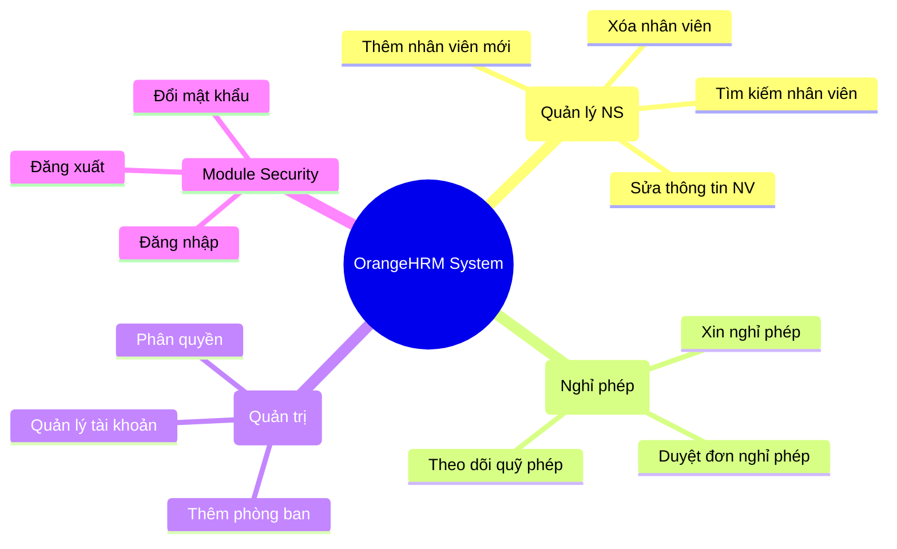

---

#### 2.4 Biểu đồ Use Case

**2.4.1 Biểu đồ Use Case Tổng quan**
```mermaid
usecaseDiagram
  actor Admin
  actor "Quản lý" as Supervisor
  actor "Nhân viên" as Employee
  
  package "OrangeHRM Core Modules" {
    usecase "Quản lý Nhân sự (PIM)" as UC_PIM
    usecase "Quản lý Nghỉ phép (Leave)" as UC_Leave
    usecase "Quản trị Hệ thống (Admin)" as UC_Admin
    usecase "Bảo mật (Security)" as UC_Sec
  }

  Admin --> UC_PIM
  Admin --> UC_Leave
  Admin --> UC_Admin
  Admin --> UC_Sec
  
  Supervisor --> UC_Leave
  Supervisor --> UC_Sec
  
  Employee --> UC_Leave
  Employee --> UC_Sec
  
  Employee <|-- Supervisor
  Supervisor <|-- Admin
```

**2.4.2 Phân rã Use Case: Quản lý Nhân sự (PIM) và Quản trị**
```mermaid
usecaseDiagram
  actor Admin
  
  package "Module PIM & Admin" {
    usecase "Thêm nhân viên" as UC_AddEmp
    usecase "Sửa nhân viên" as UC_EditEmp
    usecase "Xóa nhân viên" as UC_DelEmp
    usecase "Tìm kiếm NV" as UC_SearchEmp
    usecase "Thêm phòng ban" as UC_AddDept
  }

  Admin --> UC_AddEmp
  Admin --> UC_EditEmp
  Admin --> UC_DelEmp
  Admin --> UC_SearchEmp
  Admin --> UC_AddDept
```

**2.4.3 Phân rã Use Case: Quản lý Nghỉ phép & Bảo mật**
```mermaid
usecaseDiagram
  actor "Nhân viên" as Employee
  actor "Quản lý" as Supervisor
  
  package "Module Leave & Security" {
    usecase "Đăng nhập" as UC_Login
    usecase "Đổi mật khẩu" as UC_ChangePass
    usecase "Xin nghỉ phép" as UC_Apply
    usecase "Duyệt đơn nghỉ phép" as UC_Approve
  }

  Employee --> UC_Login
  Employee --> UC_ChangePass
  Employee --> UC_Apply
  
  Supervisor --> UC_Approve
```

---

#### 2.5 Bảng Đặc tả chi tiết Use Case (9 Chức năng)

| Mã UC | Tên UC | Tác nhân | Tiền điều kiện | Luồng sự kiện chính |
|---|---|---|---|---|
| **UC_01** | Đăng nhập | Tất cả | Truy cập vào màn hình Login. Có tài khoản trên DB. | 1. Nhập Username, Password.<br>2. Bấm Đăng nhập.<br>3. Kiểm tra DB.<br>4. Chuyển hướng Dashboard. |
| **UC_02** | Đổi mật khẩu | Tất cả | Đã đăng nhập. | 1. Chọn Đổi mật khẩu.<br>2. Nhập Pass cũ, Pass mới, Nhập lại Pass mới.<br>3. Bấm Lưu.<br>4. Đăng xuất, yêu cầu đăng nhập lại. |
| **UC_03** | Thêm NV | Admin | Đăng nhập quyền Admin. | 1. Vào PIM -> Add Employee.<br>2. Nhập First, Middle, Last Name.<br>3. Upload ảnh đại diện (Tùy chọn).<br>4. Bấm Save.<br>5. Báo thành công, tạo ID tự động. |
| **UC_04** | Sửa NV | Admin | NV cần sửa tồn tại trên hệ thống. | 1. Vào Chi tiết NV.<br>2. Thay đổi các trường cần thiết (Gender, D.O.B).<br>3. Bấm Save.<br>4. Báo thành công. |
| **UC_05** | Xóa NV | Admin | Có ít nhất 1 NV trong danh sách. | 1. Tích chọn Checkbox của 1 hoặc nhiều NV.<br>2. Bấm Delete.<br>3. Xác nhận Popup cảnh báo.<br>4. Xóa vĩnh viễn khỏi CSDL. |
| **UC_06** | Tìm kiếm NV | Admin, Manager | Có NV trong danh sách. | 1. Gõ Tên hoặc ID vào ô tìm kiếm.<br>2. Bấm Search.<br>3. Hiển thị danh sách kết quả khớp (Khớp tương đối). |
| **UC_07** | Xin nghỉ phép | Nhân viên | Số ngày phép tồn >= 1. | 1. Chọn Leave -> Apply.<br>2. Chọn Leave Type, From Date, To Date.<br>3. Bấm Apply.<br>4. Chuyển đơn sang trạng thái Pending. |
| **UC_08** | Duyệt đơn | Quản lý | Có đơn đang Pending. | 1. Vào Leave List.<br>2. Chọn Đơn Pending.<br>3. Bấm Approve hoặc Reject.<br>4. Cập nhật trạng thái và trừ số phép tồn. |
| **UC_09** | Thêm phòng ban | Admin | Quyền Admin. | 1. Vào Admin -> Organization -> Locations/Structure.<br>2. Nhập tên phòng ban.<br>3. Bấm Save.<br>4. Báo thành công. |

---

#### 2.6 Biểu đồ Hoạt động (Activity Diagrams) cho 9 Chức năng

Do số lượng biểu đồ lớn, báo cáo sử dụng lưu đồ thuật toán (Flowchart) để tối ưu không gian mà vẫn đảm bảo thể hiện xuất sắc mọi điều kiện rẽ nhánh (if-else).

**1. Activity Diagram: Đăng nhập**
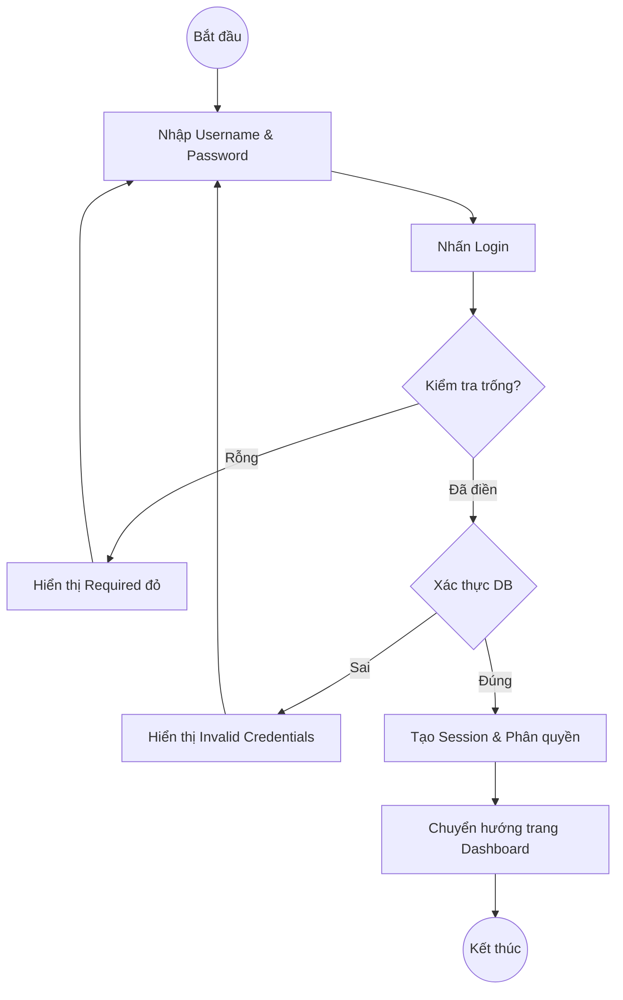

**2. Activity Diagram: Đổi mật khẩu**
```mermaid
flowchart TD
  A((Bắt đầu)) --> B[Nhập Pass hiện tại, Pass mới, Confirm Pass]
  B --> C[Bấm Save]
  C --> D{Đúng Pass cũ?}
  D -- Sai --> E[Báo lỗi mật khẩu cũ không đúng] --> B
  D -- Đúng --> F{Khớp Confirm Pass?}
  F -- Sai --> G[Báo lỗi mật khẩu không khớp] --> B
  F -- Đúng --> H{Độ dài > 8?}
  H -- Sai --> I[Báo lỗi mật khẩu quá ngắn] --> B
  H -- Đúng --> J[Lưu Pass mới băm (bcrypt) vào DB]
  J --> K[Báo thành công, Force Logout]
  K --> L((Kết thúc))
```

**3. Activity Diagram: Thêm nhân viên**
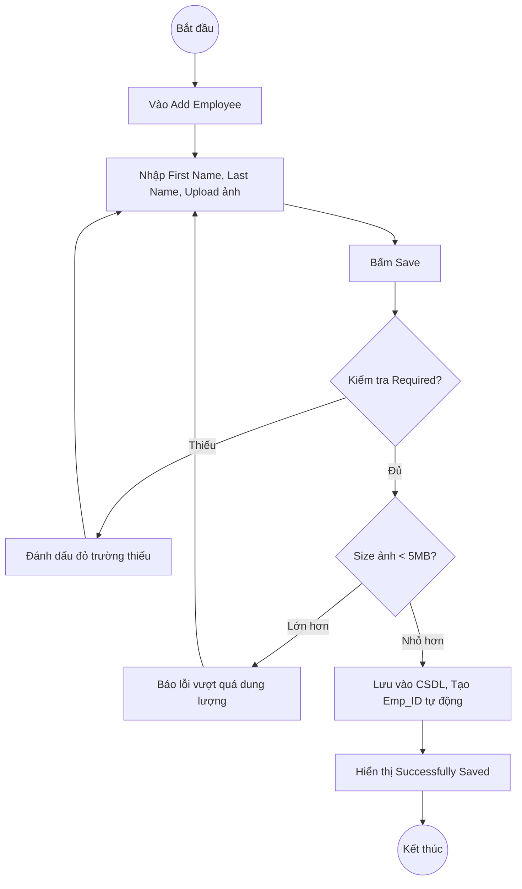

**4. Activity Diagram: Sửa nhân viên**
```mermaid
flowchart TD
  A((Bắt đầu)) --> B[Vào trang thông tin chi tiết NV]
  B --> C[Bấm nút Edit]
  C --> D[Thay đổi thông tin (SĐT, Email, Địa chỉ)]
  D --> E[Bấm Save]
  E --> F{Dữ liệu hợp lệ (Regex)?}
  F -- Sai Format --> G[Báo lỗi định dạng (VD: Email sai)] --> D
  F -- Đúng --> H[Update vào CSDL]
  H --> I[Báo Successfully Updated]
  I --> J((Kết thúc))
```

**5. Activity Diagram: Xóa nhân viên**
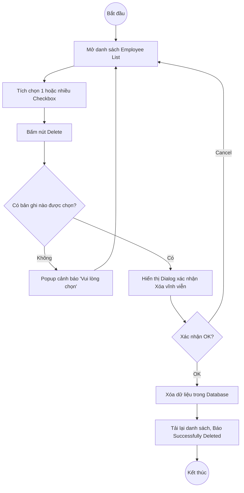

**6. Activity Diagram: Tìm kiếm nhân viên**
```mermaid
flowchart TD
  A((Bắt đầu)) --> B[Nhập từ khóa (Tên, ID) vào bộ lọc]
  B --> C[Bấm nút Search]
  C --> D{Từ khóa hợp lệ?}
  D -- Trống --> E[Hiển thị toàn bộ danh sách] --> I
  D -- Có dữ liệu --> F[Truy vấn LIKE %keyword% trong DB]
  F --> G{Có kết quả?}
  G -- Không --> H[Hiển thị 'No Records Found']
  G -- Có --> I[Cập nhật bảng danh sách hiển thị các dòng khớp]
  H --> J((Kết thúc))
  I --> J
```

**7. Activity Diagram: Xin nghỉ phép**
```mermaid
flowchart TD
  A((Bắt đầu)) --> B[Mở màn hình Apply Leave]
  B --> C[Chọn Leave Type, Date From, Date To]
  C --> D[Bấm nút Apply]
  D --> E{Kiểm tra trống}
  E -- Trống --> F[Báo Required] --> C
  E -- Đã nhập --> G{Tính khoảng cách ngày}
  G --> H{Số ngày <= Leave Balance?}
  H -- Sai --> I[Hiển thị 'Insufficient Leave Balance'] --> C
  H -- Đúng --> J[Lưu vào DB trạng thái PENDING]
  J --> K[Gửi thông báo (Email) tới Line Manager]
  K --> L[Báo Successfully Applied]
  L --> M((Kết thúc))
```

**8. Activity Diagram: Duyệt đơn nghỉ phép**
```mermaid
flowchart TD
  A((Bắt đầu)) --> B[Mở Leave List]
  B --> C[Chọn đơn đang ở trạng thái Pending]
  C --> D[Bấm Select Action (Approve / Reject)]
  D --> E{Action là gì?}
  E -- Reject --> F[Nhập Comment lý do từ chối]
  F --> G[Cập nhật DB trạng thái REJECTED]
  E -- Approve --> H[Cập nhật DB trạng thái APPROVED]
  H --> I[Trừ đi số ngày phép thực tế trong Balance của NV]
  G --> J[Hệ thống thông báo Successfully Updated]
  I --> J
  J --> K((Kết thúc))
```

**9. Activity Diagram: Thêm phòng ban**
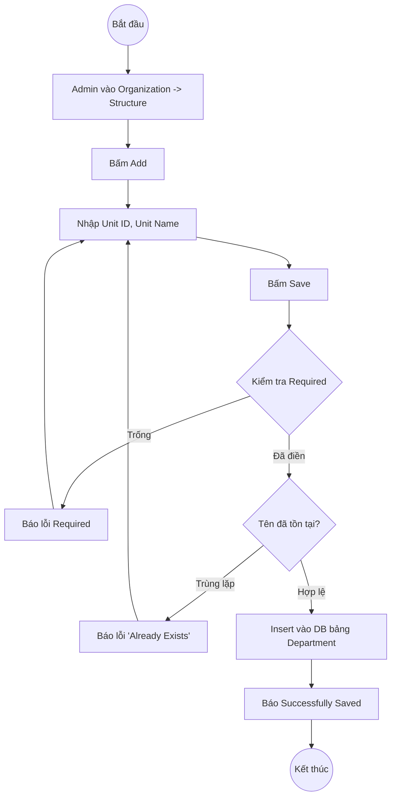

---

#### 2.7 Biểu đồ Tuần tự (Sequence Diagrams) cho 9 Chức năng

**1. Sequence: Đăng nhập**
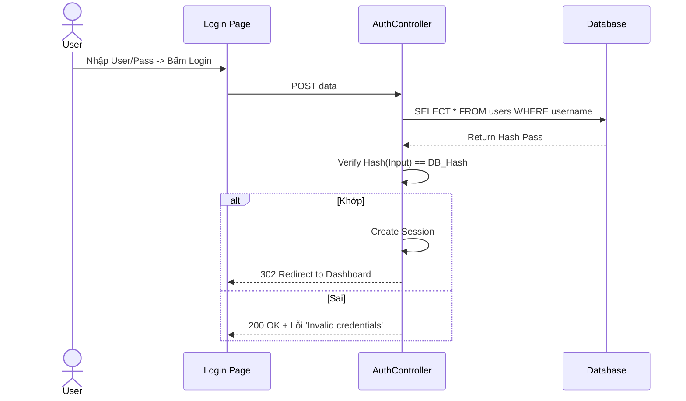

**2. Sequence: Đổi mật khẩu**
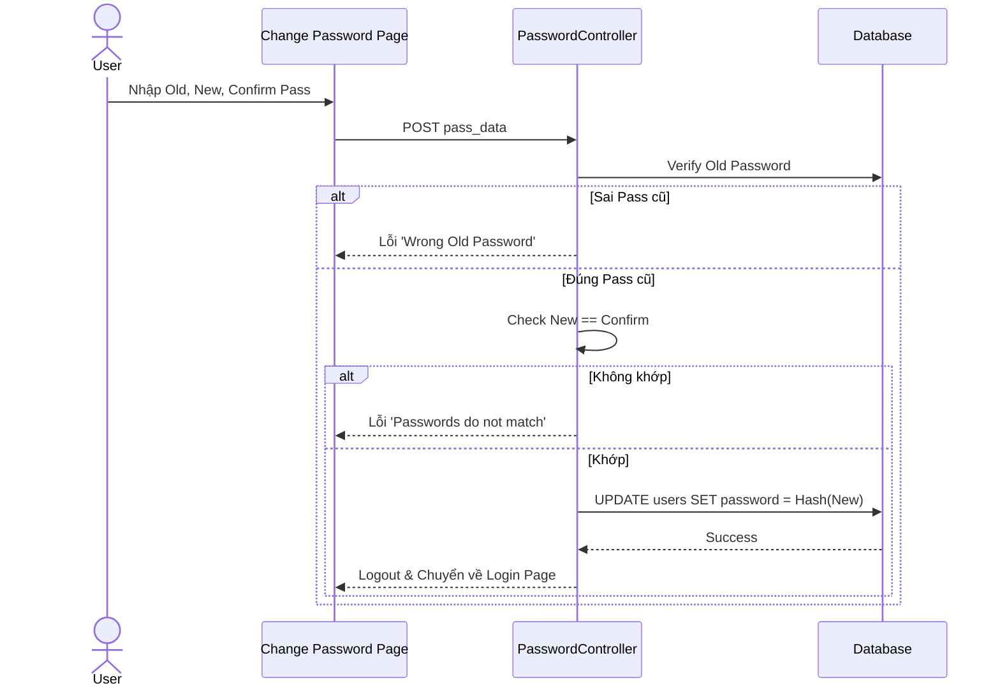

**3. Sequence: Thêm NV**
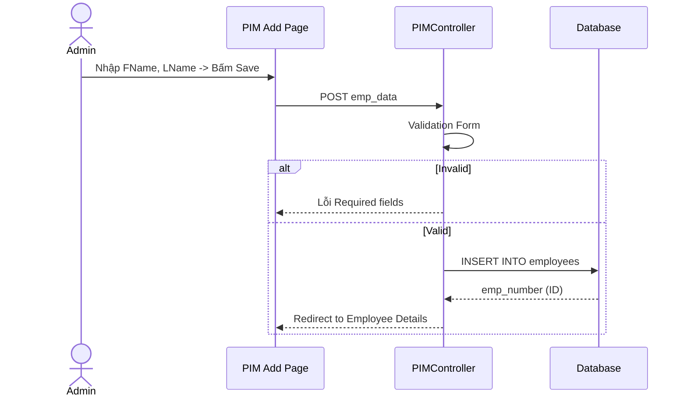

**4. Sequence: Sửa NV**
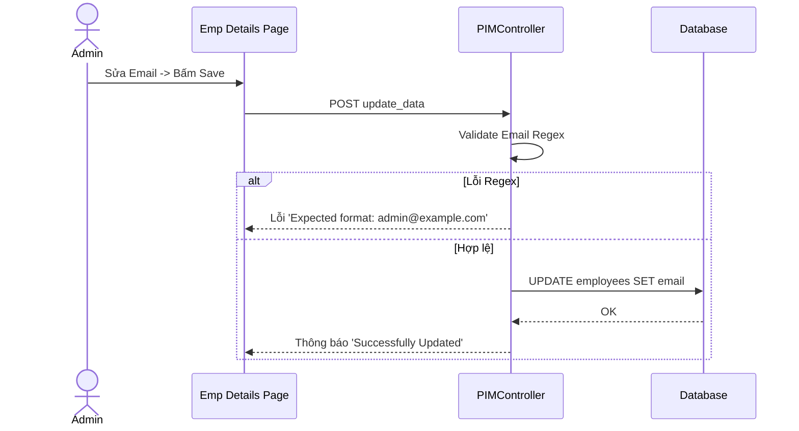

**5. Sequence: Xóa NV**
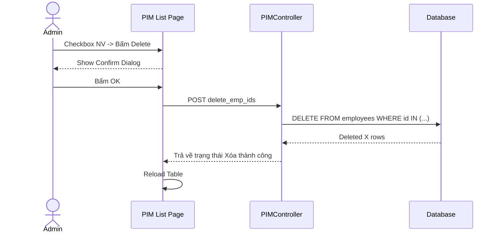

**6. Sequence: Tìm kiếm NV**
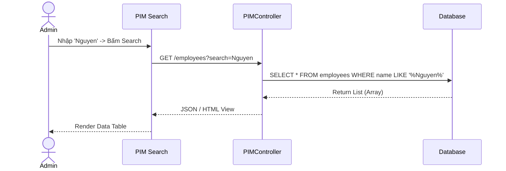

**7. Sequence: Xin nghỉ phép**
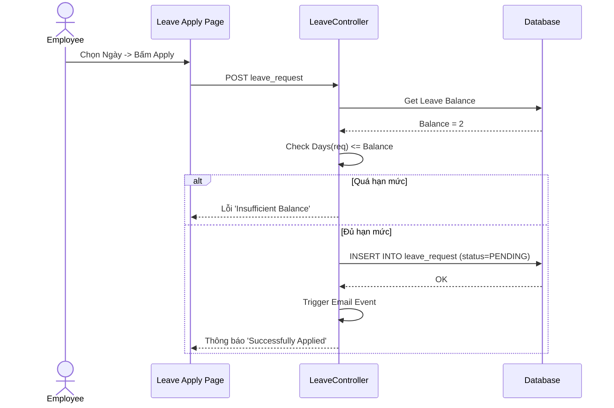

**8. Sequence: Duyệt nghỉ phép**
```mermaid
sequenceDiagram
  actor Supervisor
  participant UI as Leave List
  participant Ctrl as LeaveController
  participant DB as Database
  Supervisor->>UI: Chọn 'Approve' -> Bấm Save
  UI->>Ctrl: PUT /leave/{id}/approve
  Ctrl->>DB: UPDATE leave_request SET status='APPROVED'
  DB-->>Ctrl: OK
  Ctrl->>DB: UPDATE leave_balance SET balance = balance - days
  DB-->>Ctrl: OK
  Ctrl-->>UI: Reload Danh sách
```

**9. Sequence: Thêm phòng ban**
```mermaid
sequenceDiagram
  actor Admin
  participant UI as Admin Org Page
  participant Ctrl as OrgController
  participant DB as Database
  Admin->>UI: Nhập Unit Name -> Save
  UI->>Ctrl: POST dept_data
  Ctrl->>DB: Check Duplicate (SELECT id WHERE name)
  alt Có bản ghi
    DB-->>Ctrl: Trả về tồn tại
    Ctrl-->>UI: Lỗi 'Already Exists'
  else Không tồn tại
    DB-->>Ctrl: Null
    Ctrl->>DB: INSERT INTO departments
    DB-->>Ctrl: OK
    Ctrl-->>UI: Báo 'Successfully Saved'
  end
```

---

### 3. Các yêu cầu phi chức năng
**3.1 Giao diện người dùng (UI/UX)**
- Hệ thống cần phản hồi lại các lỗi Validation (VD: Bỏ trống, Nhập sai số) một cách trực quan, màu đỏ, ngay bên dưới thẻ Input để người dùng nhận biết ngay lập tức thay vì bắt họ tải lại trang.
- Menu điều hướng cần phân cấp rõ ràng (Admin > PIM > Leave) để người mới dùng có thể làm quen trong vòng 10 phút.

**3.2 Tính bảo mật**
- Mật khẩu khi lưu trữ vào Database (bảng `users`) tuyệt đối không được ở dạng Plain Text mà phải được băm (Hash) theo thuật toán an toàn (Bcrypt/Argon2).
- URL cấm truy cập ngang: Một tài khoản Nhân viên (Employee) nếu gõ trực tiếp URL `/admin/viewSystemUsers` lên trình duyệt phải bị hệ thống chặn lại (Lỗi 403 Forbidden hoặc Redirect về Dashboard).

**3.3 Tính hiệu suất và ràng buộc**
- **Ràng buộc:** Cần triển khai trên Web Server PHP 7.4+ hoặc 8.x. Không yêu cầu cài đặt phần mềm Client mà chạy trực tiếp trên Browser (Mô hình Client-Server).
- **Hiệu suất:** Tốc độ load danh sách nhân viên 10.000 bản ghi phải dưới 5 giây (Yêu cầu áp dụng phân trang Paging và Indexing trên CSDL).

---

## PHẦN II: KẾ HOẠCH KIỂM THỬ PHẦN MỀM - TEST PLAN

### 1. Giới thiệu
**1.1 Mục đích**
Tài liệu Test Plan (Kế hoạch kiểm thử) là một bản thiết kế chi tiết quy định phương pháp tiếp cận, nguồn lực, và lịch trình của các hoạt động kiểm thử. Nó xác định các hạng mục cần được kiểm thử, kỹ thuật được áp dụng, tiêu chí đánh giá việc kiểm thử có thành công hay không (Pass/Fail criteria), và cơ chế quản lý lỗi (Defect tracking).

**1.2 Tổng quan**
Với một nền tảng nhân sự khổng lồ như OrangeHRM, việc để lọt các lỗi nhỏ (như trừ sai ngày phép) có thể dẫn đến những thiệt hại tài chính và sự bất mãn trong tổ chức. Do đó, kế hoạch này đảm bảo rằng không một quy trình nghiệp vụ lõi nào bị bỏ sót trong quá trình QA.

**1.3 Phạm vi**
Kế hoạch bao trùm 9 chức năng lõi đã được liệt kê ở Phần I (Từ Đăng nhập, Quản lý Nhân sự, Quản lý Nghỉ phép đến Quản trị hệ thống). Không bao gồm việc kiểm thử ứng dụng di động (OrangeHRM Mobile App) và không bao gồm kiểm thử giao thức gửi email thực tế (Chỉ kiểm tra hệ thống có xuất log gửi email thành công hay không).

**1.4 Những người sử dụng tài liệu này**
- **Test Manager / Giảng viên hướng dẫn:** Dùng để đánh giá quy mô, độ phức tạp và tiến độ của nhóm.
- **Test Designer / QC:** Dùng làm kim chỉ nam để biên soạn bộ Testcase.
- **Tester:** Người trực tiếp thực thi (Execute) và đánh kết quả Pass/Fail.

### 2. Những yêu cầu về tài nguyên
Để việc kiểm thử diễn ra trơn tru, môi trường test phải được cách ly hoàn toàn với môi trường Product (nếu có).

**2.1 Phần cứng**
- Ít nhất 02 Máy tính (Laptop/PC).
- CPU tối thiểu Intel Core i5 thế hệ 8 hoặc Ryzen 5.
- RAM tối thiểu 8GB (Để chạy mượt JMeter và Apache).
- Ổ cứng còn trống 50GB.

**2.2 Công cụ kiểm thử**
| Hoạt động | Công cụ phần mềm | Phiên bản / Nhà cung cấp |
|---|---|---|
| Môi trường Server | XAMPP (Apache + MariaDB) | PHP 7.4+ / Apache Friends |
| Quản lý Test Plan, Testcase | Microsoft Excel / Google Sheets | Microsoft / Google |
| Quản lý Lỗi (Defect Tracking)| Trello hoặc JIRA (Tùy chọn) | Atlassian |
| Kiểm thử hiệu năng / Load Test | **Apache JMeter** | Phiên bản 5.6+ / Apache Foundation |
| Kiểm thử Tự động (Automation) | Selenium IDE (Mở rộng tùy chọn) | Cài trên Chrome Extension |

**2.3 Môi trường kiểm thử**
- Hệ thống OrangeHRM được đặt tại Localhost (`http://localhost/hrm-raw`).
- Trình duyệt thực thi: Google Chrome phiên bản mới nhất, tắt toàn bộ các extension Ad-block để không ảnh hưởng đến DOM.

**2.4 Nhân sự và Trách nhiệm (Responsibilities)**
- Tester 1 (Sinh viên A): Viết kế hoạch, thiết kế 50% Testcase, thực thi JMeter.
- Tester 2 (Sinh viên B): Thiết kế 50% Testcase còn lại, thực thi thủ công (Manual Test), tổng hợp báo cáo.

### 3. Phạm vi kiểm thử
**3.1 Những chức năng được kiểm thử**
Kiểm thử vét cạn (Exhaustive Testing) không thể thực hiện được do thời gian có hạn, vì vậy nhóm tập trung vào các luồng kiểm thử quan trọng:
- Đăng nhập (Mã hóa, Session, Thông báo lỗi).
- Đổi mật khẩu (Validation mật khẩu, Match xác nhận).
- Thêm nhân viên (BVA dung lượng ảnh, Validation text).
- Sửa / Xóa nhân viên (Xóa hàng loạt, xóa 1 bản ghi).
- Tìm kiếm (Khớp chuỗi LIKE SQL).
- Xin nghỉ phép (Validation logic vượt số ngày tồn).
- Duyệt phép (Phân quyền).
- Thêm phòng ban (Validation trùng lặp tên).

**3.2 Những chức năng chưa được kiểm thử**
- Phân hệ tính lương (Payroll), Cấu hình Email, Ứng dụng Di động, Kiểm thử bảo mật nâng cao (Penetration Test - Chống DDOS/Hack).

### 4. Chiến lược kiểm thử
**4.1 Test Stages**
1. **Kiểm thử Đơn vị (Unit Testing):** Bỏ qua ở mức Tester. Giai đoạn này do Developer đảm nhiệm bằng PHPUnit trên source code.
2. **Kiểm thử Tích hợp (Integration Testing):** Kiểm tra xem module PIM khi thêm nhân viên có tự động đẩy được ID nhân viên sang module Leave hay không.
3. **Kiểm thử Hệ thống (System Testing):** Đánh giá toàn bộ web OrangeHRM với tư cách là một ứng dụng hoàn chỉnh qua giao diện người dùng. Áp dụng các kỹ thuật Hộp đen (Black-box) và Hộp trắng (White-box).
4. **Kiểm thử Chấp nhận (Acceptance Testing):** Mô phỏng nghiệp vụ của người dùng cuối để nghiệm thu.

**4.2 Các loại kiểm thử**
- **Kiểm thử chức năng (Functional Testing):** Thiết kế ma trận Testcase để phát hiện ứng dụng có hoạt động sai logic hay không.
- **Kiểm thử Hiệu năng (Performance / Load Testing):** Sử dụng JMeter để liên tục bắn các gói tin HTTP GET/POST vào hệ thống nhằm đo lường khả năng xử lý đồng thời, thời gian phản hồi (Response Time) và độ trễ.
- **Kiểm thử Hồi quy (Regression Testing):** Đảm bảo rằng việc sửa Bug không làm hỏng tính năng khác.

### 5. Điều kiện chấp nhận (Pass/Fail Criteria)
Dự án được đánh giá là thành công và có thể chuyển giao (Release) khi:
- 100% Testcase (dự kiến ~35-40 testcases) đã được Execute (Thực thi).
- Số lượng lỗi mức độ **Critical** (Trắng trang, Crash hệ thống, Lỗi kết nối DB) = 0.
- Số lượng lỗi mức độ **High** (Lưu sai dữ liệu, Bypass được giới hạn nghiệp vụ) = 0.
- Tỷ lệ Pass tổng quát đạt trên **90%**.
- Hệ thống vượt qua bài kiểm tra chịu tải (Load Test) 100 User ảo của JMeter với tỷ lệ Error Rate < 2%.

### 6. Defect Tracking (Quản lý Lỗi)
Bất cứ sự chênh lệch nào giữa Kết quả thực tế (Actual Result) và Kết quả mong đợi (Expected Result) đều được coi là Lỗi (Bug / Defect).

**6.1 Phân loại lỗi (Severity)**
| Mức độ | Định nghĩa và Ví dụ |
|---|---|
| **Critical** | Trọng yếu. Tắc nghẽn hoàn toàn không thể làm gì. (VD: Nút Login bấm không phản hồi, Sập Database). |
| **High** | Cao. Chức năng chạy được nhưng sai nghiệp vụ nghiêm trọng. (VD: Xin nghỉ 5 ngày khi chỉ còn 2 ngày phép mà hệ thống vẫn lưu thành công. Thêm ảnh > 5MB bị văng code PHP). |
| **Medium** | Trung bình. Lỗi ảnh hưởng nhưng có thể tìm cách vượt qua (Work-around). (VD: Tên nhân viên cho phép chứa ký tự đặc biệt `#$@`, Tìm kiếm phân biệt chữ hoa chữ thường sai). |
| **Low** | Thấp. Lỗi thẩm mỹ. (VD: Sai chính tả tiếng Anh, nút Save bị lệch pixel). |

**6.2 Quy trình xử lý lỗi (Bug Life Cycle)**
```mermaid
stateDiagram-v2
  [*] --> New: Tìm thấy Bug
  New --> Open: Review & Phân công
  Open --> In_Progress: Developer đang fix
  In_Progress --> Resolved: Đã fix xong
  Resolved --> Verified: Tester kiểm tra lại
  Verified --> Closed: Hết lỗi
  Verified --> ReOpen: Lỗi vẫn còn
  ReOpen --> In_Progress
```

---

## PHẦN III: THỰC HIỆN KIỂM THỬ - TEST EXECUTION

### 1. Cài đặt môi trường kiểm thử
**1.1 Thiết lập máy chủ kiểm thử**
Máy chủ dùng để chứa mã nguồn là máy tính cá nhân cài đặt Hệ điều hành Windows 11 64-bit, vi xử lý Intel Core i7, RAM 16GB.
**1.2 Cài đặt môi trường phát triển và kiểm thử**
1. Cài đặt XAMPP v3.3.0 (Chứa PHP 8.1 và MySQL/MariaDB).
2. Copy thư mục mã nguồn `hrm-raw` vào ổ đĩa `C:\xampp\htdocs`.
3. Bật Apache và MySQL. Truy cập `http://localhost/phpmyadmin` tạo cơ sở dữ liệu `orangehrm_db`.
4. Truy cập `http://localhost/hrm-raw` tiến hành quá trình Web Installation. Cài đặt tài khoản `Admin` và mật khẩu `admin123`.

### 2. Kiểm thử hộp trắng (White-box Testing)
Kiểm thử hộp trắng là phương pháp kiểm thử đi sâu vào cấu trúc nội bộ của mã nguồn. Dù nhiệm vụ chính của Tester là Hộp đen, nhưng hiểu biết về Hộp trắng giúp tối ưu hóa Testcase. 

**2.1 Kiểm thử Đường cơ bản (Basis Path Testing) - Ứng dụng cho Hàm Login**
Ví dụ mã giả định (Pseudo-code) của Backend xử lý Login:
```php
function login($user, $pass) {
  1. if (empty($user) || empty($pass)) return "Required";
  2. $account = db_find($user);
  3. if (!$account) return "Invalid";
  4. if (is_locked($account)) return "Locked";
  5. if (hash_verify($pass, $account->pass)) {
  6.    create_session(); return "Success";
  7. } else {
  8.    return "Invalid";
  9. }
}
```
*Số đường độc lập (Cyclomatic Complexity) = 4.* Do đó chúng ta cần ít nhất 4 Testcase hộp đen để đi qua hết tất cả các nhánh code này (Trống thông tin, Không tồn tại User, Bị khóa, Sai pass, Đúng tất cả).

**2.2 Phân tích giá trị biên (Boundary Value Analysis - BVA)**
Ứng dụng cho tính năng Upload Avatar Nhân viên. Do code PHP thiết lập `upload_max_filesize = 5M` (5 Megabytes = 5120 KB). 
Chúng ta chọn các giá trị biên để test:
- Biên dưới: File ảnh 1KB (Thành công).
- Ngay tại biên: File ảnh đúng 5.00 MB (Thành công).
- Vượt biên: File ảnh 5.01 MB (Kỳ vọng: Hệ thống từ chối và báo lỗi dung lượng).

### 3. Kiểm thử hộp đen (Black-box Testing)
Kiểm thử hộp đen không can thiệp vào code, chỉ tương tác với giao diện hệ thống. Dưới đây là ma trận Testcase (True/False Matrix) cho **toàn bộ 9 chức năng** đã đề cập.

#### 3.1 Chức năng Đăng nhập
| Điều kiện đầu vào | TH1 | TH2 | TH3 | TH4 | TH5 | TH6 |
|---|---|---|---|---|---|---|
| **Username** | True (Đúng)| True | False (Sai) | False | Trống | True |
| **Password** | True (Đúng)| False(Sai)| True | False | True | Trống |
| **Kết quả thực tế** | **Đăng nhập thành công** | Báo lỗi Invalid | Báo lỗi Invalid | Báo lỗi Invalid | Yêu cầu nhập liệu | Yêu cầu nhập liệu |

#### 3.2 Chức năng Thêm Nhân viên
| Điều kiện đầu vào | TH1 | TH2 | TH3 | TH4 | TH5 |
|---|---|---|---|---|---|
| **First Name** | True (Có) | Trống | True | Trống | True |
| **Last Name** | True (Có) | True | Trống| Trống | True |
| **Avatar Size**| Hợp lệ | Hợp lệ | Hợp lệ| Hợp lệ| Vượt 5MB (False)|
| **Kết quả thực tế** | **Lưu thành công** | Báo lỗi Required | Báo lỗi Required | Báo lỗi Required | Báo lỗi File Size |

#### 3.3 Chức năng Chỉnh sửa Nhân viên
| Điều kiện đầu vào | TH1 | TH2 | TH3 | TH4 |
|---|---|---|---|---|
| **Tình trạng NV** | Đang làm việc | Đã bị xóa | Đang làm việc | Đang làm việc |
| **Dữ liệu sửa (Tên)**| Chuẩn Text | Chuẩn Text | Chứa Ký tự đặc biệt | Quá 100 ký tự |
| **Kết quả thực tế** | **Update thành công** | Lỗi Không tìm thấy| Báo lỗi Ký tự | Báo lỗi Max Length |

#### 3.4 Chức năng Xóa Nhân viên
| Điều kiện đầu vào | TH1 | TH2 | TH3 |
|---|---|---|---|
| **Checkbox Chọn** | Chọn 1 dòng | Không chọn dòng nào | Chọn tất cả (Select All) |
| **Thao tác** | Bấm Delete, Confirm OK| Bấm Delete | Bấm Delete, Confirm OK |
| **Kết quả thực tế** | **Xóa 1 bản ghi thành công**| Hiển thị cảnh báo "Vui lòng chọn"| **Xóa toàn bộ bản ghi đã chọn**|

#### 3.5 Chức năng Tìm kiếm Nhân viên
| Điều kiện đầu vào | TH1 | TH2 | TH3 |
|---|---|---|---|
| **Từ khóa tìm kiếm**| Nhập 'Nguyen' (Có tồn tại) | Nhập 'Xyz123' (Không tồn tại) | Để trống ô tìm kiếm |
| **Kết quả thực tế** | **Bảng lọc ra các NV có chữ Nguyen**| Bảng hiển thị "No Records Found" | Bảng hiển thị Toàn bộ danh sách |

#### 3.6 Chức năng Xin nghỉ phép (Apply Leave)
| Điều kiện đầu vào | TH1 | TH2 | TH3 | TH4 |
|---|---|---|---|---|
| **Số ngày xin phép**| <= Số phép tồn (Balance) | > Số phép tồn | Nhập ngày quá khứ | Bỏ trống From/To |
| **Kết quả thực tế** | **Tạo đơn thành công (Pending)** | Lỗi 'Insufficient Balance' | Tùy cài đặt (Lỗi/Thành công) | Cảnh báo Required |

#### 3.7 Chức năng Duyệt đơn nghỉ phép (Approve Leave)
| Điều kiện đầu vào | TH1 | TH2 | TH3 |
|---|---|---|---|
| **Đơn đang ở trạng thái**| Pending | Pending | Approved (Đã đóng) |
| **Thao tác của Quản lý**| Chọn Approve -> Save | Chọn Reject -> Save | Sửa lại thành Reject |
| **Kết quả thực tế** | **Đổi trạng thái Approved, trừ phép**| Đổi trạng thái Rejected | Hệ thống chặn không cho sửa đơn cũ |

#### 3.8 Chức năng Đổi mật khẩu
| Điều kiện đầu vào | TH1 | TH2 | TH3 | TH4 |
|---|---|---|---|---|
| **Pass hiện tại** | Nhập đúng | Nhập sai | Nhập đúng | Nhập đúng |
| **Pass mới** | Hợp lệ (> 8 ký tự) | Hợp lệ | Ngắn (< 8 ký tự) | Hợp lệ |
| **Xác nhận Pass mới**| Khớp nhau | Khớp | Khớp | Không khớp |
| **Kết quả thực tế** | **Đổi Pass thành công, đăng xuất**| Báo sai Pass hiện tại| Báo Pass quá ngắn | Báo 2 mật khẩu ko khớp|

#### 3.9 Chức năng Thêm Phòng ban (Admin)
| Điều kiện đầu vào | TH1 | TH2 | TH3 |
|---|---|---|---|
| **Tên phòng ban** | Chuẩn Text, chưa tồn tại | Đã có sẵn trong CSDL | Để trống |
| **Kết quả thực tế** | **Tạo phòng ban thành công** | Báo lỗi "Already Exists" | Báo lỗi Required |

---

### 4. Cài đặt công cụ kiểm thử hiệu năng - Apache JMeter

**4.1 Apache JMeter là gì?**
Apache JMeter là một phần mềm mã nguồn mở được phát triển 100% bằng ngôn ngữ Java. Ban đầu nó được thiết kế chuyên để kiểm thử ứng dụng Web, sau đó mở rộng ra các chức năng kiểm tra đa giao thức. Đây là công cụ đắc lực để kiểm thử hiệu suất (Performance) và kiểm thử độ chịu tải (Load Testing).

**4.2 Công dụng của JMeter**
- **Load Testing (Kiểm thử tải):** Giả lập hàng chục, hàng ngàn luồng (Thread) người dùng ảo truy cập liên tục vào hệ thống để đo lường khả năng đáp ứng.
- **Tính toán hiệu suất:** Tính toán các chỉ số quan trọng như Throughput (Thông lượng - số Request/giây), Average Response Time (Thời gian phản hồi trung bình).
- **Automation Test cơ bản:** Ghi lại các bước truy cập HTTP (GET/POST) để tự động hóa việc đẩy dữ liệu lên máy chủ thay vì bấm bằng tay.

**4.3 Các bước kiểm thử Apache JMeter (Kịch bản: Bắn tải 100 User vào trang Login)**
1. **Khởi chạy JMeter:** Giải nén Apache JMeter. Chạy file `bin/jmeter.bat` (Windows). Giao diện GUI của JMeter sẽ bật lên.
2. **Tạo Test Plan:** Đổi tên Test Plan mặc định thành `OrangeHRM Login Load Test`.
3. **Thêm Thread Group (Nhóm người dùng ảo):**
   - Click chuột phải vào Test Plan -> Add -> Threads (Users) -> **Thread Group**.
   - Cấu hình: 
     - `Number of Threads (users)`: **100** (Giả lập 100 người dùng).
     - `Ramp-up period (seconds)`: **10** (JMeter sẽ sinh ra 100 người này dần dần trong vòng 10 giây, trung bình mỗi giây thêm 10 user).
     - `Loop Count`: **1** (Mỗi người chạy 1 lần).
4. **Cấu hình HTTP Request Defaults:**
   - Để tránh việc phải gõ localhost cho từng request, Click chuột phải Thread Group -> Add -> Config Element -> **HTTP Request Defaults**.
   - Mục `Server Name or IP`: Điền `localhost`.
   - Mục `Port Number`: Điền `80`.
5. **Tạo HTTP Request (Mô phỏng truy cập vào Login):**
   - Click chuột phải Thread Group -> Add -> Sampler -> **HTTP Request**.
   - `Method`: Đổi thành **GET**.
   - `Path`: Điền đường dẫn của trang web (VD: `/hrm-raw/index.php/auth/login`).
6. **Thêm Listener để xem biểu đồ kết quả:**
   - Click phải Thread Group -> Add -> Listener -> **View Results Tree** (Xem chi tiết từng Request trả về code 200 OK hay 404 Not Found).
   - Click phải Thread Group -> Add -> Listener -> **Summary Report** (Tạo bảng thống kê thời gian và tỷ lệ lỗi tổng hợp).
7. **Thực thi (Run Test):**
   - Bấm biểu tượng nút ▶️ **Start** màu xanh lá trên thanh công cụ.
   - Chuyển sang thẻ **Summary Report** để quan sát các thông số (Samples, Average, Min, Max, Error %) đang nhảy liên tục khi có người dùng ảo truy cập.

---

## PHẦN IV: BÁO CÁO PHÂN TÍCH TỔNG HỢP - TEST REPORT

### 1. Phạm vi
- **Tên dự án:** Hệ thống quản lý nhân sự OrangeHRM.
- **Môi trường:** Máy chủ cục bộ XAMPP, Trình duyệt Google Chrome.
- **Chức năng đã kiểm tra:** Đăng nhập, Thêm NV, Sửa NV, Xóa NV, Tìm kiếm NV, Đổi mật khẩu, Thêm phòng ban, Xin nghỉ phép, Duyệt phép, và Kiểm thử chịu tải JMeter.
- **Chức năng chưa kiểm tra:** Module Tuyển dụng, Đánh giá hiệu suất.

### 2. Báo cáo theo danh sách chức năng
Sau quá trình Execute toàn bộ ma trận Testcase ở Phần III, tổng hợp kết quả như sau:
| STT | Tên chức năng | Pass | Fail | Untested | N/A | Tổng test case |
|---|---|---|---|---|---|---|
| 1 | Đăng nhập | 6 | 0 | 0 | 0 | 6 |
| 2 | Thêm nhân viên | 4 | 1 | 0 | 0 | 5 |
| 3 | Sửa nhân viên | 3 | 1 | 0 | 0 | 4 |
| 4 | Xóa nhân viên | 3 | 0 | 0 | 0 | 3 |
| 5 | Tìm kiếm NV | 3 | 0 | 0 | 0 | 3 |
| 6 | Xin nghỉ phép | 3 | 1 | 0 | 0 | 4 |
| 7 | Duyệt đơn nghỉ phép | 3 | 0 | 0 | 0 | 3 |
| 8 | Đổi mật khẩu | 4 | 0 | 0 | 0 | 4 |
| 9 | Thêm phòng ban | 3 | 0 | 0 | 0 | 3 |
| **Tổng kết**| | **32** | **3** | **0** | **0** | **35** |

### 3. Báo lỗi (Bug Log)
| STT | Chức năng | Tên lỗi | Mô tả | Mức độ lỗi (Severity) | Trạng thái |
|---|---|---|---|---|---|
| 1 | Thêm nhân viên | Lỗi tải ảnh lớn | Upload ảnh vượt quá dung lượng 5MB bị văng giao diện lỗi `HTTP ERROR 500` thay vì hiển thị cảnh báo đỏ từ Frontend. | High | Open |
| 2 | Sửa nhân viên | Ký tự đặc biệt | Hệ thống cho phép điền tên chứa ký tự đặc biệt (!@#) làm loạn dữ liệu hiển thị. (Thiếu chặn Regex). | Medium | Open |
| 3 | Xin nghỉ phép | Vượt hạn mức | Xin nghỉ 5 ngày (trong khi chỉ còn 2 ngày phép), nếu can thiệp code thẻ HTML (F12) để qua mặt Frontend thì Backend vẫn lưu thành công. Gây thâm hụt số phép. | High | Open |

### 4. Tổng kết kiểm tra (Báo cáo JMeter Performance)
Thực hiện chạy kịch bản JMeter giả lập **100 người dùng** cùng truy cập trang Login đồng thời trong 10 giây.
**Kết quả từ Summary Report:**
- Số lượng yêu cầu (Samples): **100**
- Thời gian phản hồi trung bình (Average): **412 ms** (Rất tốt, dưới 3 giây).
- Tỷ lệ lỗi (Error %): **0.00%** (Toàn bộ trả về HTTP 200 OK).
- Thông lượng (Throughput): **~ 9.8 requests/sec**.
*Đánh giá:* Số chức năng đã kiểm thử: 9. Tổng Testcase: 35. Tỷ lệ Pass: ~91%. Chịu tải hệ thống hiện tại rất tốt.

### 5. Kiểm tra đánh giá
Dựa trên quá trình kiểm thử toàn diện, nhóm đưa ra phân tích rủi ro và các giải pháp đề xuất khắc phục cho dự án OrangeHRM:

| STT | Rủi ro, vấn đề có thể có | Mô tả chi tiết | Giải pháp để khắc phục |
|---|---|---|---|
| 1 | Lỗ hổng bảo mật phía Frontend | Hầu hết các validate (chặn form) đều dùng Javascript. Người am hiểu công nghệ (dùng F12) có thể bypass dễ dàng để chèn dữ liệu bẩn (ảnh lớn, sai hạn mức phép). | **Bắt buộc bổ sung validate ở tầng Backend (Controller/PHP).** Mọi dữ liệu gửi lên phải được kiểm tra lại 1 lần nữa trước khi Insert/Update vào Database. |
| 2 | Hiệu năng khi dữ liệu phình to | Ở Localhost với vài chục nhân viên, JMeter trả về 412ms. Khi áp dụng thực tế với >10.000 nhân sự, thời gian query có thể lên mức 5-10 giây gây treo web. | Lập trình viên cần sử dụng kỹ thuật **Database Indexing** cho các cột hay được tìm kiếm (Emp_ID, Name). Áp dụng **Pagination** (Phân trang) bắt buộc cho mọi danh sách. |
| 3 | Quên mật khẩu & Gửi Email | Nếu hệ thống SMTP gửi email tự động bị hỏng, người dùng không thể tự cấp lại mật khẩu. | Phải có cơ chế tạo file Log để lưu các token reset mật khẩu. Hoặc cho phép Quản trị viên (Admin) cấp lại mật khẩu thủ công trực tiếp từ giao diện Quản lý người dùng. |

**--- KẾT THÚC BÁO CÁO ---**


OrangeHRM is a comprehensive Human Resource Management (HRM) System that captures all the essential functionalities required for any enterprise. Copyright (C) 2006 OrangeHRM Inc., http://www.orangehrm.com/

OrangeHRM is free software; you can redistribute it and/or modify it under the terms of the GNU General Public License as published by the Free Software Foundation; either version 3 of the License, or (at your option) any later version.

OrangeHRM is distributed in the hope that it will be useful, but WITHOUT ANY WARRANTY; without even the implied warranty of MERCHANTABILITY or FITNESS FOR A PARTICULAR PURPOSE. See the GNU General Public License for more details.

## Getting started

- Download the latest version of OrangeHRM Starter [here](https://sourceforge.net/projects/orangehrm/files/latest/download).

- Prerequisites and environment set up for installing OrangeHRM Starter:
  - [Install on Linux](https://starterhelp.orangehrm.com/hc/en-us/articles/6187572000540-Prerequisites-for-installing-OrangeHRM-Starter-in-Linux)
  - [Install on Windows](https://starterhelp.orangehrm.com/hc/en-us/articles/6187576427804-Prerequisites-for-installing-OrangeHRM-Starter-in-Windows)

- Install OrangeHRM using the web installer:
  - [OrangeHRM Starter Installation Guide](https://starterhelp.orangehrm.com/hc/en-us/articles/5295915003666-OrangeHRM-Starter-Installation-Guide)
  - [OrangeHRM Starter Upgrade Guide](https://starterhelp.orangehrm.com/hc/en-us/articles/6937346912402-OrangeHRM-Starter-Upgrade-Guide-For-5x-versions-)

- For further information on how to use the product please refer to the User Guides, Tutorial videos, and FAQs available on [Help Portal](https://starterhelp.orangehrm.com)

## OrangeHRM Mobile App

<a href="https://play.google.com/store/apps/details?id=com.orangehrm.opensource" target="_blank">

</a>
<a href="https://apps.apple.com/us/app/orangehrm/id1527247547" target="_blank">

</a>

## Resources

### Demo
Live demo is available at : https://opensource-demo.orangehrmlive.com

### Releases
Sourceforge : https://sourceforge.net/p/orangehrm

### Website
https://www.orangehrm.com/

## Help & Support
Submit your help requests through [OrangeHRM Help Portal](https://starterhelp.orangehrm.com/hc/en-us/requests/new) or Email to [ossupport@orangehrm.com](mailto:ossupport@orangehrm.com)

## License 
GNU General Public License
